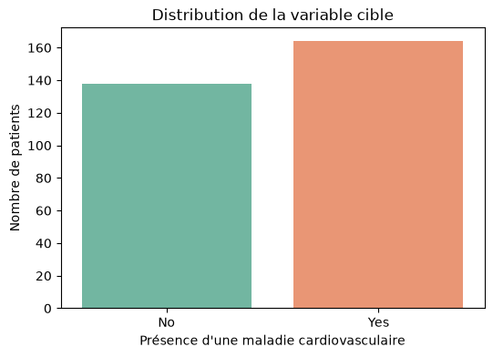
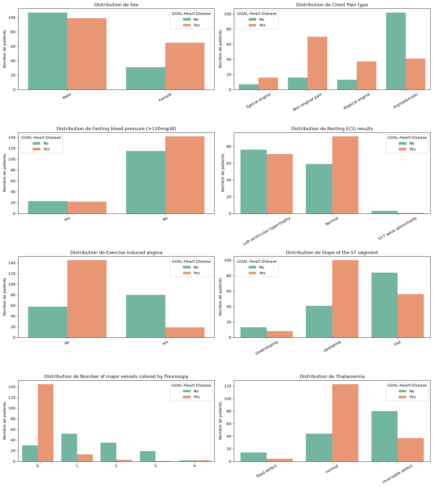
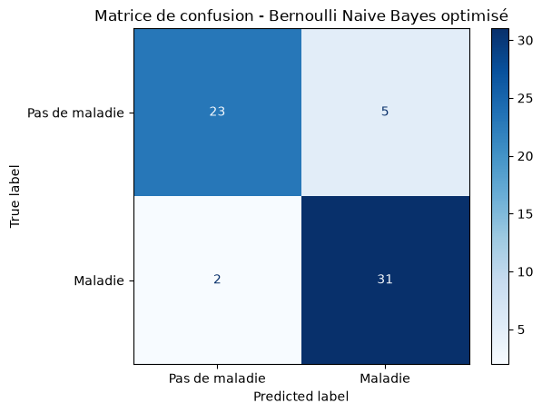
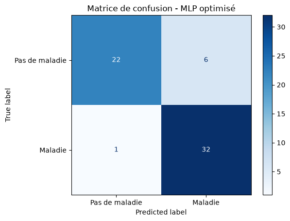
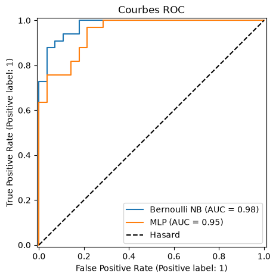

# <div align="center">Cardiovascular-Disease-Prediction</div>

<div align="center">


<p align="center">
  
</p>


> Classification de la présence d'une maladie cardiovasculaire à partir de variables cliniques discrètes,  
> en comparant un **Bernoulli Naive Bayes** et un **perceptron multicouche (MLP)**.
</div>

## Sommaire

### Approche Data & Insights
1. [Problématique](#1---problématique)
2. [Données](#2---données)
3. [Analyse Exploratoire des Données (EDA)](#3---analyse-exploratoire-des-données-eda)
4. [Modélisation](#4---modélisation)
5. [Résultats & comparaison](#5---résultats--comparaison)
6. [Limites & perspectives](#6---limites--perspectives)

### Stack & Utilisation
7. [Stack technique](#7---stack-technique)
8. [Structure du projet](#8---structure-du-projet)
9. [Installation & Utilisation](#9---installation--utilisation)
10. [License](#-license)


---


## 1 - Problématique

Les maladies cardiovasculaires comptent parmi les premières causes de mortalité dans le monde. Un dépistage précoce, appuyé par des données cliniques simples à recueillir, peut aider les professionnels de santé à prioriser les examens complémentaires.

**Question centrale :** peut-on prédire la présence d'une maladie cardiovasculaire à partir des caractéristiques cliniques discrètes d'un patient, et quel modèle (probabiliste ou réseau de neurones) est le plus adapté ?

Le projet impose une contrainte méthodologique : **seules les variables discrètes sont conservées** (7 qualitatives + 1 quantitative discrète), les 5 variables quantitatives continues étant écartées. Deux modèles supervisés sont ensuite entraînés, optimisés par validation croisée et comparés.


---


## 2 - Données

| Élément | Détail |
|---|---|
| **Fichier** | `data/Cardiovascular Disease Prediction.csv` (séparateur `;`) |
| **Observations** | 303 brutes → **302 après suppression d'1 doublon** |
| **Variables** | 14 colonnes (13 explicatives + 1 cible) |
| **Valeurs manquantes** | Aucune |
| **Variable cible** | `GOAL-Heart Disease` (`Yes` / `No`) |

**Répartition de la cible** : 164 patients malades (**54,3 %**) contre 138 non malades (**45,7 %**). Les classes sont relativement équilibrées, aucun rééchantillonnage n'est nécessaire.

<p align="center">
  
</p>

### Variables conservées (8 variables discrètes)

| Variable | Type |
|---|---|
| `Sex` | Qualitative |
| `Chest Pain type` | Qualitative |
| `Fasting blood pressure (>120mg/dl)` | Qualitative |
| `Resting ECG results` | Qualitative |
| `Exercise induced angina` | Qualitative |
| `Slope of the ST segment` | Qualitative |
| `Thalassemia` | Qualitative |
| `Number of major vessels colored by flourosopy` | Quantitative discrète |

Variables continues écartées : âge, pression artérielle au repos, cholestérol sérique, fréquence cardiaque maximale, dépression du segment ST.

> Plus de détails dans [`data/README.md`](data/README.md).


---


## 3 - Analyse Exploratoire des Données (EDA)

- **Qualité des données** : contrôle des types, des valeurs manquantes et des doublons (1 ligne dupliquée supprimée).
- **Variable cible** : analyse de la distribution pour vérifier l'équilibre des classes.
- **Variables discrètes** : diagrammes en barres croisés avec la cible pour repérer les modalités où la proportion de patients positifs est la plus marquée (certains types de douleur thoracique, absence d'angine à l'effort...).

> Ces visualisations mettent en évidence des **associations statistiques** au sein de l'échantillon, sans permettre de conclure à un lien de cause à effet.

<p align="center">
  
</p>

| Observation dans l'échantillon | Détail |
|---|---|
| **Type de douleur thoracique** | Les patients positifs dominent nettement pour la douleur non angineuse ; les asymptomatiques sont majoritairement négatifs |
| **Angine à l'effort** | Les patients sans angine à l'effort sont majoritairement positifs, et inversement |
| **Vaisseaux colorés par fluoroscopie** | Les patients avec 0 vaisseau coloré sont majoritairement positifs ; à partir de 1 vaisseau, les négatifs dominent |
| **Thalassémie** | Majorité de positifs pour le type `normal`, majorité de négatifs pour `reversable defect` |
| **Sexe** | Proportion de positifs plus élevée chez les femmes de l'échantillon |
| **Glycémie à jeun** | Peu discriminante (répartition similaire entre les deux classes) |

---


## 4 - Modélisation

### Prétraitement

| Étape | Détail |
|---|---|
| Séparation X / y | `y` encodée : `No` → 0, `Yes` → 1 |
| Split Train / Test | 80 % / 20 % (**241 / 61 patients**), `random_state=42`, `stratify=y` |
| Encodage | `OneHotEncoder(handle_unknown="ignore")` : 8 variables → **24 variables binaires** (requis par Bernoulli NB) |

L'encodeur est ajusté sur le jeu d'entraînement uniquement, puis appliqué au jeu de test, ce qui évite toute fuite de données.

### Modèle 1 : Bernoulli Naive Bayes

Prédit la classe la plus probable selon le théorème de Bayes, sous hypothèse d'indépendance des variables sachant la classe :

$$\hat{y} = \arg\max_{y}\; P(y)\prod_{i=1}^{n} P(x_i \mid y)$$

- **Avantages** : rapide, interprétable, adapté aux petits jeux de données.
- **Limite** : ignore les interactions entre variables.
- **Optimisation** : `GridSearchCV` (CV = 5 plis, métrique : F1)

```python
param_grid = {"alpha": [0.01, 0.1, 0.5, 1, 2, 3, 5]}
```

### Modèle 2 : Perceptron multicouche (MLP)

Réseau de neurones capable d'apprendre des relations non linéaires entre variables.

- **Optimisation** : `GridSearchCV` (CV = 5 plis, métrique : F1), solver `adam`, `early_stopping=True`

```python
param_grid_mlp = {
    "hidden_layer_sizes": [(8,), (16,), (32,), (16, 8)],
    "alpha":              [1e-4, 1e-3, 1e-2, 1e-1],
    "activation":         ["relu", "tanh"],
}
```

### Meilleurs hyperparamètres

| Modèle | Hyperparamètres retenus | F1 (validation croisée) |
|---|---|---|
| Bernoulli Naive Bayes | `alpha = 3` | 0,880 |
| MLP | `activation="tanh"`, `alpha=1e-4`, `hidden_layer_sizes=(32,)` | 0,743 |


---


## 5 - Résultats & comparaison

Performances sur l'**ensemble de test (61 patients)** :

| Modèle | Accuracy | Précision | Rappel | F1-score | ROC-AUC |
|---|---|---|---|---|---|
| Bernoulli Naive Bayes | 0,885 | **0,861** | 0,939 | 0,899 | **0,98** |
| MLP | 0,885 | 0,842 | **0,970** | **0,901** | 0,95 |


### Matrices de confusion (ensemble de test)

<p align="center">
  
  
</p>

| Modèle | Vrais négatifs | Faux positifs | Faux négatifs | Vrais positifs |
|---|---|---|---|---|
| Bernoulli Naive Bayes | 23 | 5 | 2 | 31 |
| MLP | 22 | 6 | 1 | 32 |

### Courbes ROC

<p align="center">
  
</p>


### Interprétation

- Les deux modèles obtiennent une **accuracy identique (88,5 %)** et des F1-scores quasi équivalents.
- **MLP** : meilleur **rappel** (97,0 % vs 93,9 %), il détecte davantage de patients réellement malades.
- **Bernoulli NB** : meilleure **précision** (86,1 % vs 84,2 %), donc moins de faux positifs, et une meilleure AUC (0,98 vs 0,95).
- Dans un contexte de dépistage médical, le **rappel** est souvent prioritaire (un faux négatif est plus coûteux qu'un faux positif), ce qui avantage légèrement le MLP. Le Bernoulli NB reste très compétitif pour un modèle bien plus simple.
- L'écart entre les deux modèles correspond à **un seul patient** de l'ensemble de test.


---


## 6 - Limites & perspectives

| Limite | Piste d'amélioration |
|---|---|
| Jeu de test très réduit (61 patients) : l'écart entre modèles n'est pas statistiquement significatif | Validation croisée répétée / intervalles de confiance |
| Variables continues écartées par choix méthodologique | Comparer avec un modèle exploitant toutes les variables (âge, cholestérol, fréquence cardiaque max...) |
| Dataset de petite taille (302 patients) | Valider sur un jeu de données externe |
| MLP : F1 en validation croisée (0,743) nettement inférieur à celui du test (0,901) | `early_stopping` = False |


---


## 7 - Stack technique

| Catégorie | Technologies |
|---|---|
| **Langage** | Python 3.12 |
| **Data & ML** | Pandas, NumPy, Scikit-Learn |
| **Modèles** | `BernoulliNB`, `MLPClassifier` |
| **Optimisation** | `GridSearchCV` |
| **Évaluation** | Accuracy, Précision, Rappel, F1-score, matrices de confusion, courbes ROC |
| **Visualisation** | Matplotlib, Seaborn |
| **Notebook** | Jupyter |

---

## 8 - Structure du projet

```plaintext
CARDIOVASCULAR-DISEASE-PREDICTION/
│
├── data/
│   ├── Cardiovascular Disease Prediction.csv   # Jeu de données (303 observations, 14 colonnes)
│   └── README.md                               # Informations détaillées sur les données
│
├── image/
│   ├── Image_du_Projet.jpg                     # Image d'illustration principale
│   ├── distribution_cible.png                  # Répartition de la variable cible
│   ├── distribution_variables.png              # Distribution des variables discrètes
│   ├── matrice_confusion_bayes.png             # Matrice de confusion - Bernoulli NB
│   ├── matrice_confusion_mlp.png               # Matrice de confusion - MLP
│   └── courbes_roc.png                         # Courbes ROC comparatives
│
├── modele/
│   └── .gitkeep
│
├── notebook/
│   └── Cardiovascular-Disease-Prediction.ipynb # EDA, prétraitement, modélisation & comparaison
│
├── .gitignore
├── LICENSE
├── README.md
└── requirements.txt                            # Liste des dépendances Python
```


---

## 9 - Installation & Utilisation

**1. Cloner le dépôt et installer les dépendances**

```bash
git clone https://github.com/keinlarry/Cardiovascular-Disease-Prediction.git
cd Cardiovascular-Disease-Prediction
pip install -r requirements.txt
```

**2. Lancer le notebook**

```bash
jupyter notebook notebook/Cardiovascular-Disease-Prediction.ipynb
```

> 💡 **Note** : dans le notebook, le chemin du fichier CSV est défini en absolu (`/workspaces/Cardiovascular-Disease-Prediction/data/...`). Pensez à l'adapter à votre environnement local, par exemple `../data/Cardiovascular Disease Prediction.csv`.


---

## 📄 License

Ce projet est sous **MIT License**.

#